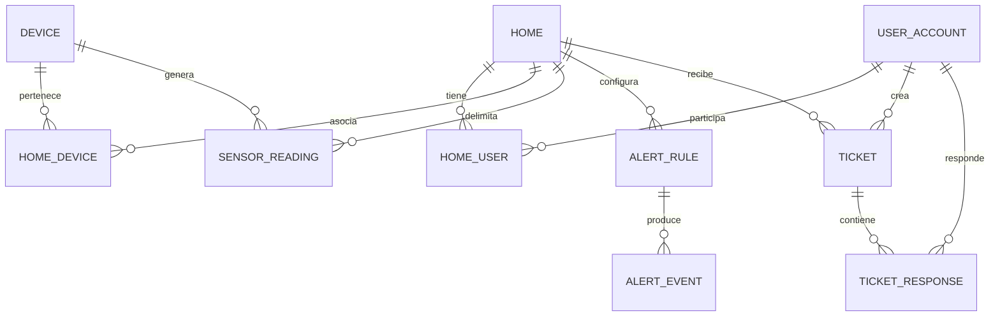

# Modelo entidad-relación de HidroSmart

Este es un mapa conceptual del núcleo operativo; no sustituye las columnas,
restricciones ni claves foráneas que declaran las migraciones de
[`01_ddl/03_tables`](../01_ddl/03_tables) y [`01_ddl/04_alter`](../01_ddl/04_alter).
El esquema puede evolucionar: ante diferencias, prevalece el SQL aplicado.

## Entidades y límites

- `user_account.user_account` representa una identidad de acceso. Roles,
  permisos, credenciales y sesiones se modelan aparte; no son miembros del hogar.
- `home.home` es el límite de propiedad y aislamiento de datos. `home.home_user`
  asocia usuarios y hogares con el rol de membresía `Owner`, `Member` o `Guest`.
- `device.device` representa el equipo IoT. `home.home_device` registra su
  asociación con un hogar y su estado; conservar esta asociación separada permite
  historizar y controlar el vínculo.
- `consumption.sensor_reading` guarda lecturas. El contexto de hogar y el
  dispositivo deben corresponder a una asociación válida para aceptar ingesta.
- `alert_rate.alert_rule` define reglas y `alert_rate.alert_event` conserva los
  eventos generados.
- `analytics_support.ticket` y `ticket_response` modelan soporte e interacción.

## Lectura del flujo

1. Una identidad participa en uno o más hogares mediante `home_user`.
2. El hogar administra uno o más dispositivos mediante `home_device`.
3. Cada lectura se atribuye al dispositivo y al hogar autorizado; los resúmenes
   y vistas analíticas derivan de estas lecturas.
4. Alertas y reportes consultan datos del hogar, conservando el ámbito de acceso.

Las relaciones dibujadas son conceptuales. Para verificar cardinalidades,
columnas obligatorias, cascadas, unicidad y claves foráneas, consulta los SQL
de tablas y alteraciones. Los roles globales de aplicación (por ejemplo,
`Administrator`, `HomeUser`, `Guest`) no deben confundirse con los roles de
membresía del hogar.
